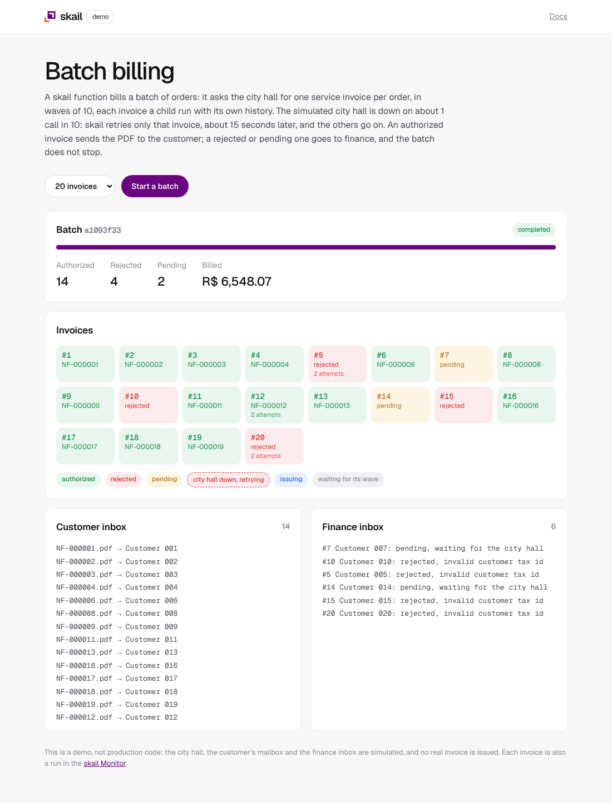

# skail batch billing (.NET 8)

[Português (Brasil)](README.pt-BR.md)

An app with a skail function that bills a batch of orders: it asks the city hall for one service invoice per order, in waves of 10, and consolidates the result when every invoice is done. Each invoice is a child run with its own history, so when the city hall is unavailable, skail retries only that invoice and the others go on. An authorized invoice sends the PDF to the customer; a rejected or pending one goes to finance, and the batch does not stop. You start the batches on a page the app serves at http://localhost:8080.

It shows three skail features:

- **fan-out and fan-in**: one child run per invoice, in waves of 10, joined by a wait for all of them;
- **automatic retries**: the simulated city hall is unavailable on about 1 call in 10, and skail retries only that invoice;
- **results instead of errors**: a rejection is a result, not an exception, and an invoice that fails on every attempt becomes pending, so the batch always completes.

## Requirements

- One of: [Docker](https://docs.docker.com/get-docker/), [Podman](https://podman.io/docs/installation) or the [.NET 8 SDK](https://dotnet.microsoft.com/download/dotnet/8.0) (or newer). The run script uses the first one it finds.
- A skail environment with a workload registered for the `SKAIL_WORKLOAD` in `.env` (`batchbilling:v1.0.0` by default). The [Quickstart](https://docs.skail.dev/comece-aqui/quickstart) shows how to create the account, the environment and the workload.

The project uses `Skail.Platform.Runtime` **2.3.0-rc.4**.

## Run

```bash
cp .env.example .env  # fill in SKAIL_SIDECAR, SKAIL_NAMESPACE and SKAIL_KEY (portal > Environments & keys > Connect)
scripts/run.sh        # then open http://localhost:8080
```

On Windows, in PowerShell: `copy .env.example .env`, then `powershell -ExecutionPolicy Bypass -File scripts\run.ps1`. The script works on the Windows PowerShell built into Windows; PowerShell 7 is not needed.

The script runs the demo with what the machine has: Docker, then Podman, then the .NET SDK. If it finds none of them, it says what to install. Without the script, the commands are `dotnet run`.



Pick the size of the batch (10, 20 or 50 invoices) and click **Start a batch**. Each invoice is a square that changes color as it goes: waiting for its wave, issuing, city hall down and retrying, then authorized, rejected or pending; the ones the city hall refused at first show how many attempts they took. The **Customer inbox** gets the PDFs of the authorized invoices, and the **Finance inbox** gets the rejected and pending ones, with the reason. The page refreshes itself every second, and each step is also printed to the console.

## The paths

The simulated city hall rejects the orders whose number is a multiple of 5 (invalid customer tax id), leaves pending the multiples of 7 and authorizes the rest. Its answer is the same for the same order, so a retry gets the same invoice.

| What you click | What happens | Result |
|---|---|---|
| **Start a batch** with 10 invoices | one wave of 10 | **completed**: 7 authorized, 2 rejected, 1 pending |
| **Start a batch** with 20 invoices | two waves of 10 | **completed**: 14 authorized, 4 rejected, 2 pending |
| **Start a batch** with 50 invoices | five waves of 10 | **completed**: 34 authorized, 10 rejected, 6 pending |
| any batch, when the city hall is unavailable on a call | skail retries only that invoice, about 15 seconds later | the same result; the invoice shows its attempts |

An invoice never shows up in both inboxes, nor twice in the same one. The amount billed adds only the authorized invoices.

## How it works

The app does three jobs in one process: it serves the page, it hosts the worker that runs the functions (`builder.UseSkail()`), and it starts each batch through the skail HTTP API. The city hall, the customer's mailbox and the finance inbox are simulated in the same process.

```http
POST {SKAIL_SIDECAR}/api/v1/trigger/batchbilling/v1.0.0/BillBatch/{batchId}
["{batchId}", 20]
```

The functions, in [`BillingFunctions.cs`](BillingFunctions.cs):

```csharp
[SkailFunction]
public async SkailTask<BatchResult> BillBatch(string batchId, int size)
{
    var orders = Orders.Generate(batchId, size);
    var invoices = new List<Invoice>();
    foreach (var wave in orders.Chunk(BatchLimits.WaveSize))
    {
        var issuing = wave.Select(order => IssueInvoice(batchId, size, order)).ToArray();
        await SkailTask.WhenAll(issuing);
        foreach (var invoice in issuing)
            invoices.Add(await invoice);
    }

    var result = BatchResult.Consolidate(batchId, invoices);
    await ReportResult(batchId, size, result, invoices);
    return result;
}

[SkailFunction]
public async SkailTask<Invoice> IssueInvoice(string batchId, int size, Order order)
{
    Invoice invoice;
    try
    {
        invoice = await IssueAtCityHall(batchId, size, order);
    }
    catch (Exception ex) when (ex is not SkailNonDeterministicException)
    {
        invoice = Invoice.Pending(order, "city hall unavailable");
    }

    if (invoice.IsAuthorized)
        await SendPdfToCustomer(batchId, size, invoice);
    else
        await NotifyFinance(batchId, size, invoice);
    return invoice;
}
```

- The orders come from arithmetic over the batch id and the size, so `BillBatch` stays deterministic; in a real system a command would load them.
- Each `IssueInvoice` call becomes a child run, with its own history and its own entry in the Monitor. The function creates the 10 child runs of a wave before waiting, so they run in parallel, and the next wave starts when the current one ends: the city hall never gets more than 10 requests at once.
- After `WhenAll`, the invoices are read in the order they were created, not in the order they finished.
- A rejected or pending invoice is a result: the city hall answered, and `NotifyFinance` hands it to finance. Only an outage throws, so skail retries `IssueAtCityHall` for that invoice, up to 5 times (`[SkailCommand(retryCount: 5)]`). If every attempt fails, `IssueInvoice` catches the error and the invoice becomes pending.
- The order id (batch id and order number) is the idempotency key at the city hall, and the invoice number keeps each inbox from getting the same invoice twice when a command is retried.

| File | What it has |
|---|---|
| `BillingFunctions.cs` | The functions and their commands. |
| `Model.cs` | The orders, the invoices and the result of the batch. |
| `Demo/SimulatedCityHall.cs` | The simulated city hall. |
| `Demo/BillingDesk.cs` | Starts the batches for the page, plays the two inboxes, and keeps what the page shows. |
| `Page/index.html` | The page, with the skail branding. |
| `Skail/SkailApiClient.cs` | The trigger through the skail HTTP API. |
| `Program.cs` | Reads `.env`, serves the page and its API, and wires everything up. |
| `scripts/run.sh`, `scripts/run.ps1`, `Dockerfile` | Run the demo with Docker, Podman or .NET, whatever the machine has. |

## See the durability

1. Run `scripts/run.sh`, open the page, pick 50 invoices and click **Start a batch**.
2. While the first waves run, press **Ctrl+C**. The app closes; the batch stays in skail.
3. Run `scripts/run.sh` again and open the page. skail hands the app the batch: it goes on from where it was and ends with the 50 invoices. The invoices issued before the restart are not issued again, and the final result fills them in on the page. An invoice that was in the middle of its call to the city hall when the app closed can take a few minutes to be handed out again; the batch waits for it.

In the portal, open the [Monitor](https://docs.skail.dev/referencia/portal/monitor) of your environment and click the batch: it lists the `IssueInvoice` child runs inside each `WhenAll` and the final `ReportResult`. Each `IssueInvoice` shows its own commands: `IssueAtCityHall`, then `SendPdfToCustomer` or `NotifyFinance`. An invoice retried after an outage shows the failed attempts of its `IssueAtCityHall`.

## Notes

- There is no button to stop a batch: once started, it runs to the end. The page shows the latest batch.
- Apps running the same `SKAIL_WORKLOAD` on the same environment share the same runs: use one workload (or environment) per person.

## Disclaimer

**This is a demo, not production code.** It exists only to show how [skail](https://docs.skail.dev) works and is provided "as is", without warranty of any kind. The city hall, the customer's mailbox and the finance inbox are simulated: no real invoice is issued or sent.

## License

[Apache-2.0](LICENSE)
