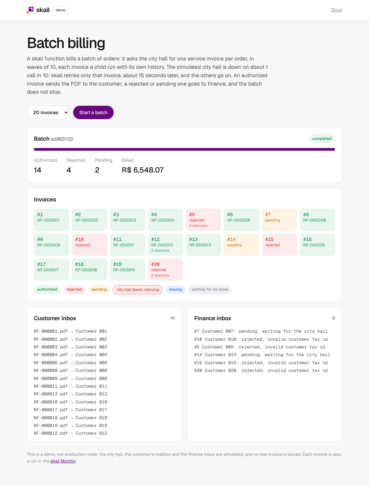

# skail batch billing (.NET 8)

[English](README.md)

Um app com uma function do skail que fatura um lote de pedidos: pede à prefeitura uma nota fiscal de serviço por pedido, em ondas de 10, e consolida o resultado quando todas as notas terminam. Cada nota é uma execução filha com o seu próprio histórico, então, quando a prefeitura fica fora do ar, o skail tenta de novo só aquela nota e as outras seguem. Uma nota autorizada manda o PDF para o cliente; uma rejeitada ou pendente vai para o financeiro, e o lote não para. Você inicia os lotes numa página que o app serve em http://localhost:8080.

Ele mostra três recursos do skail:

- **fan-out e fan-in**: uma execução filha por nota, em ondas de 10, juntadas por uma espera por todas;
- **novas tentativas automáticas**: a prefeitura simulada fica fora do ar em cerca de 1 chamada a cada 10, e o skail tenta de novo só aquela nota;
- **resultados em vez de erros**: uma rejeição é um resultado, não uma exceção, e uma nota que falha em todas as tentativas fica pendente, então o lote sempre termina.

## Requisitos

- Um destes: [Docker](https://docs.docker.com/get-docker/), [Podman](https://podman.io/docs/installation) ou o [SDK do .NET 8](https://dotnet.microsoft.com/download/dotnet/8.0) (ou mais novo). O script de execução usa o primeiro que encontrar.
- Um environment do skail com um workload registrado para o `SKAIL_WORKLOAD` do `.env` (`batchbilling:v1.0.0` por padrão). O [Quickstart](https://docs.skail.dev/comece-aqui/quickstart) mostra como criar a conta, o environment e o workload.

O projeto usa o `Skail.Platform.Runtime` **2.3.0-rc.4**.

## Rodar

```bash
cp .env.example .env  # preencha SKAIL_SIDECAR, SKAIL_NAMESPACE e SKAIL_KEY (portal > Environments & keys > Connect)
scripts/run.sh        # depois abra http://localhost:8080
```

No Windows, no PowerShell: `copy .env.example .env` e depois `powershell -ExecutionPolicy Bypass -File scripts\run.ps1`. O script funciona no Windows PowerShell que já vem no Windows; não precisa do PowerShell 7.

O script roda a demo com o que a máquina tiver: Docker, depois Podman, depois o SDK do .NET. Se não achar nenhum, ele diz o que instalar. Sem o script, os comandos são `dotnet run`.



Escolha o tamanho do lote (10, 20 ou 50 notas) e clique em **Start a batch**. Cada nota é um quadrado que muda de cor conforme anda: esperando a sua onda, sendo emitida, prefeitura fora do ar e nova tentativa, e por fim autorizada, rejeitada ou pendente; as que a prefeitura recusou de início mostram quantas tentativas levaram. A **Customer inbox** recebe os PDFs das notas autorizadas, e a **Finance inbox** recebe as rejeitadas e as pendentes, com o motivo. A página se atualiza sozinha a cada segundo, e cada passo também aparece no console.

## Os caminhos

A prefeitura simulada rejeita os pedidos cujo número é múltiplo de 5 (CNPJ do cliente inválido), deixa pendentes os múltiplos de 7 e autoriza o resto. A resposta é a mesma para o mesmo pedido, então uma nova tentativa recebe a mesma nota.

| O que você clica | O que acontece | Resultado |
|---|---|---|
| **Start a batch** com 10 notas | uma onda de 10 | **completed**: 7 autorizadas, 2 rejeitadas, 1 pendente |
| **Start a batch** com 20 notas | duas ondas de 10 | **completed**: 14 autorizadas, 4 rejeitadas, 2 pendentes |
| **Start a batch** com 50 notas | cinco ondas de 10 | **completed**: 34 autorizadas, 10 rejeitadas, 6 pendentes |
| qualquer lote, quando a prefeitura fica fora do ar numa chamada | o skail tenta de novo só aquela nota, cerca de 15 segundos depois | o mesmo resultado; a nota mostra as tentativas |

Uma nota nunca aparece nas duas caixas de entrada, nem duas vezes na mesma. O valor faturado soma só as notas autorizadas.

## Como funciona

O app faz três coisas no mesmo processo: serve a página, hospeda o worker que executa as functions (`builder.UseSkail()`) e inicia cada lote pela API HTTP do skail. A prefeitura, a caixa de entrada do cliente e a do financeiro são simuladas no mesmo processo.

```http
POST {SKAIL_SIDECAR}/api/v1/trigger/batchbilling/v1.0.0/BillBatch/{batchId}
["{batchId}", 20]
```

As functions, em [`BillingFunctions.cs`](BillingFunctions.cs):

```csharp
[SkailFunction]
public async SkailTask<BatchResult> BillBatch(string batchId, int size)
{
    var orders = Orders.Generate(batchId, size);
    var invoices = new List<Invoice>();
    foreach (var wave in orders.Chunk(BatchLimits.WaveSize))
    {
        var issuing = wave.Select(order => IssueInvoice(batchId, size, order)).ToArray();
        await SkailTask.WhenAll(issuing);
        foreach (var invoice in issuing)
            invoices.Add(await invoice);
    }

    var result = BatchResult.Consolidate(batchId, invoices);
    await ReportResult(batchId, size, result, invoices);
    return result;
}

[SkailFunction]
public async SkailTask<Invoice> IssueInvoice(string batchId, int size, Order order)
{
    Invoice invoice;
    try
    {
        invoice = await IssueAtCityHall(batchId, size, order);
    }
    catch (Exception ex) when (ex is not SkailNonDeterministicException)
    {
        invoice = Invoice.Pending(order, "city hall unavailable");
    }

    if (invoice.IsAuthorized)
        await SendPdfToCustomer(batchId, size, invoice);
    else
        await NotifyFinance(batchId, size, invoice);
    return invoice;
}
```

- Os pedidos saem de uma conta sobre o id do lote e o tamanho, então o `BillBatch` continua determinístico; num sistema real, um command carregaria os pedidos.
- Cada chamada de `IssueInvoice` vira uma execução filha, com o seu próprio histórico e a sua própria linha no Monitor. A function cria as 10 execuções filhas de uma onda antes de esperar, então elas rodam em paralelo, e a próxima onda começa quando a atual termina: a prefeitura nunca recebe mais de 10 pedidos ao mesmo tempo.
- Depois do `WhenAll`, as notas são lidas na ordem em que foram criadas, não na ordem em que terminaram.
- Uma nota rejeitada ou pendente é um resultado: a prefeitura respondeu, e o `NotifyFinance` passa a nota para o financeiro. Só uma queda lança exceção, então o skail tenta de novo o `IssueAtCityHall` daquela nota, até 5 vezes (`[SkailCommand(retryCount: 5)]`). Se todas as tentativas falharem, o `IssueInvoice` trata o erro e a nota fica pendente.
- O id do pedido (id do lote e número do pedido) é a chave de idempotência na prefeitura, e o número da nota impede que uma caixa de entrada receba a mesma nota duas vezes quando um command é repetido.

| Arquivo | O que tem |
|---|---|
| `BillingFunctions.cs` | As functions e os commands delas. |
| `Model.cs` | Os pedidos, as notas e o resultado do lote. |
| `Demo/SimulatedCityHall.cs` | A prefeitura simulada. |
| `Demo/BillingDesk.cs` | Inicia os lotes da página, faz o papel das duas caixas de entrada e guarda o que a página mostra. |
| `Page/index.html` | A página, com a marca do skail. |
| `Skail/SkailApiClient.cs` | O trigger pela API HTTP do skail. |
| `Program.cs` | Lê o `.env`, serve a página e a API dela, e liga tudo. |
| `scripts/run.sh`, `scripts/run.ps1`, `Dockerfile` | Rodam a demo com Docker, Podman ou o .NET, o que houver na máquina. |

## Veja a durabilidade

1. Rode `scripts/run.sh`, abra a página, escolha 50 notas e clique em **Start a batch**.
2. Enquanto as primeiras ondas rodam, aperte **Ctrl+C**. O app fecha; o lote continua no skail.
3. Rode `scripts/run.sh` de novo e abra a página. O skail entrega o lote ao app: ele continua de onde estava e termina com as 50 notas. As notas emitidas antes do reinício não são emitidas de novo, e o resultado final preenche essas notas na página. Uma nota que estava no meio da chamada à prefeitura quando o app fechou pode levar alguns minutos para ser entregue de novo; o lote espera por ela.

No portal, abra o [Monitor](https://docs.skail.dev/referencia/portal/monitor) do seu environment e clique no lote: ele lista as execuções filhas `IssueInvoice` dentro de cada `WhenAll` e o `ReportResult` final. Cada `IssueInvoice` mostra os seus próprios commands: `IssueAtCityHall` e depois `SendPdfToCustomer` ou `NotifyFinance`. Uma nota que teve nova tentativa depois de uma queda mostra as tentativas com falha do `IssueAtCityHall`.

## Observações

- Não há botão para parar um lote: depois de iniciado, ele vai até o fim. A página mostra o lote mais recente.
- Apps rodando o mesmo `SKAIL_WORKLOAD` no mesmo environment dividem as mesmas execuções: use um workload (ou environment) por pessoa.

## Aviso

**Esta é uma demonstração, não é código de produção.** Ela existe só para mostrar como o [skail](https://docs.skail.dev) funciona e é fornecida "como está", sem garantia de nenhum tipo. A prefeitura, a caixa de entrada do cliente e a do financeiro são simuladas: nenhuma nota real é emitida nem enviada.

## Licença

[Apache-2.0](LICENSE)
